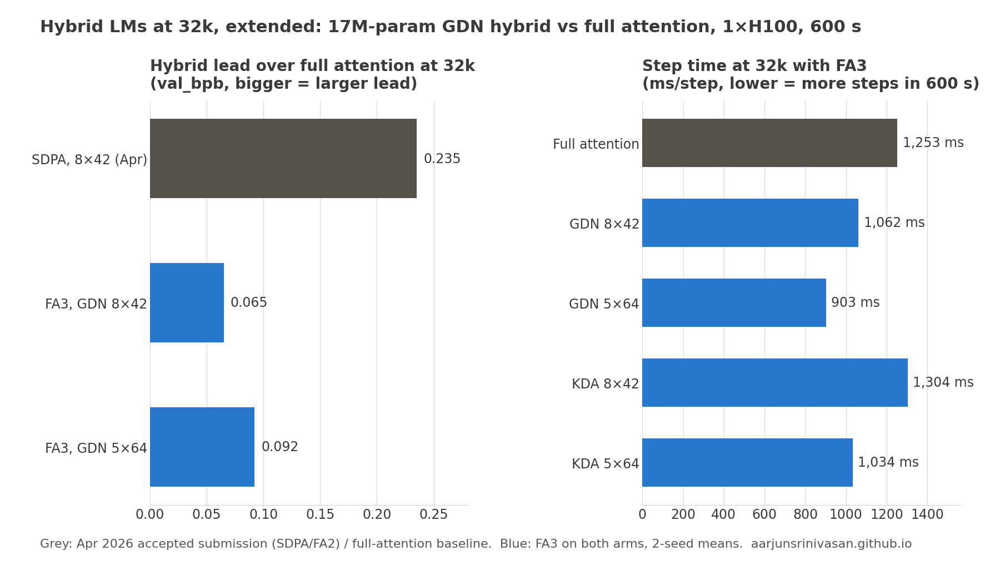

# OpenAI Parameter Golf, Re-checked: How Much of a Hybrid LM's Long-Context Win Was the Attention Kernel?

*A Parameter Golf non-record submission accepted on 2026-04-04. Updated 2026-10-28 with an FA3 follow-up.*

> **Update, Oct 2026.** I re-ran the 32k comparison on an H100 with FlashAttention-3 on *both* arms and a wall-clock-tied schedule. The hybrid still wins, but by much less:
> - **SDPA baseline (April record):** hybrid ahead by 0.235 bpb.
> - **FA3 on both arms:** hybrid ahead by 0.065. Full attention gets 1.76× faster, the hybrid 1.23×.
> - **FA3 + GDN head dim 42 → 64:** hybrid ahead by 0.092 (1.3908 vs 1.4829 val_bpb). Steps are 15% faster and per-step loss is unchanged.
> - **Kimi Delta Attention in place of GDN:** no per-step gain, 14–23% slower, and it loses at both shapes.

## Follow-up, Oct 2026: re-checking the result with a fair attention kernel

The original comparison had a weak spot. The baseline ran attention through PyTorch SDPA (FlashAttention-2), and the hybrid's whole advantage was step time. If full attention gets a faster kernel, the baseline fits more steps into 600 seconds, and the margin should shrink. So I re-ran the headline 32k comparison on an H100 with **FlashAttention-3 on both arms**. I also changed the schedule: warmup and warmdown are now fractions of the wall-clock budget rather than step counts tuned for one kernel's speed.

### Step 1: reproduce the original run first

The April hybrid, rerun unchanged (SDPA, step-count schedule, seed 1342) on the new machine, reproduced: same parameter count (17,424,332), train loss 6.9344 / 5.9570 / 3.2037 at steps 1 / 10 / 100 against 6.9344 / 5.9574 / 3.2059 originally. It scored 1.4630 vs 1.4703, slightly better because this H100 ran 4% faster per step (1308 vs 1361 ms).

### Step 2: FA3 on both arms

| Arm (seq 32768, FA3) | Params | ms/step | Steps | val_bpb (2 seeds) | vs baseline |
|---|---:|---:|---:|---:|---:|
| Full-attention baseline | 17.06M | 1253 | 480 | 1.4829 ± 0.0013 | — |
| GDN hybrid 8×42 (April shape) | 17.42M | 1062 | 565 | 1.4184 ± 0.0003 | −0.0645 |
| **GDN hybrid 5×64** | 17.00M | **903** | 665 | **1.3908 ± 0.0005** | **−0.0922** |
| KDA hybrid 8×42 | 17.86M | 1304 | 460 | 1.4632 ± 0.0007 | −0.0197 |
| KDA hybrid 5×64 | 17.68M | 1034 | 581 | 1.4119 ± 0.0026 | −0.0711 |

FA3 speeds up full attention 1.76× (2202 → 1253 ms/step) but the hybrid only 1.23× (1308 → 1062), because only 2 of its 9 layers are attention. The hybrid's quality lead falls from **0.235 to 0.065 bpb**. The hybrid still wins, but most of the April effect size came from the baseline's setup (kernel and schedule), not the architecture.

### Step 3: a head dim that the kernel actually uses

With width 448 and 8 heads, the GDN head dim is 42, which the flash-linear-attention kernels pad to 64: a third of every key lane was wasted. **5 heads × 64** keeps almost the same key/value width (320/640 vs 336/672), uses slightly fewer parameters, and makes steps **15% faster** (1062 → 903 ms), about 100 more steps in 600 s. Per-step val_bpb is identical (1.9013 vs 1.8976 at step 100, 1.4766 vs 1.4760 at step 400), so the gain is purely speed. The lead grows back to **0.092 bpb**.

### Step 4: does Kimi Delta Attention help?

Swapping only GDN's per-head decay gate for KDA's per-channel decay (checked numerically against `chunk_gated_delta_rule` first) gives no per-step gain and a 14–23% slower kernel. KDA trails GDN by +0.045 bpb at 8×42 and +0.021 at 5×64.

### What this changes

About 70% of the original margin disappeared once both arms got FA3 and a wall-clock schedule. Kernel, schedule and day all changed together, so the 70% can't be pinned on the kernel alone. The next run to separate them is an SDPA baseline under the wall-clock schedule.

1. **Equal kernels for both arms.** Under a fixed compute budget, an architecture comparison is partly a kernel comparison.
2. **Tie schedules to the budget, not to step counts.** Otherwise a faster kernel silently changes the LR schedule.
3. **Check shapes against what the kernel computes.** A head dim of 42 cost 15% of the step time.

Limitations: only seq 32768; two seeds per arm (largest spread ±0.0026); KDA tested as a decay-gate swap only.

Code and logs: [2026-10-28_GDN_Hybrid_FA3_H100](https://github.com/aarjunsrinivasan/parameter-golf/tree/gdn_fa3_h100/records/track_non_record_16mb/2026-10-28_GDN_Hybrid_FA3_H100).

## Original study (Apr 2026)

The rest of this post is the April write-up as submitted, with SDPA (FlashAttention-2) attention on the baseline.

## One-line result

This study tests whether the Gated Delta Net hybrid pattern from OLMo Hybrid helps a very small language model train at long context lengths. In this constrained setting, the answer was conditional but useful: full attention was better at 8k context, while the hybrid crossed over between 8k and 16k and was substantially better at 32k under the same 600-second single-H100 budget.

At 32k context, the hybrid reached a 2-seed mean `final_int8_zlib_roundtrip` score of **1.4709 val_bpb**, compared with **1.7059 val_bpb** for the full-attention baseline.

## Research question

Parameter Golf rewards models that do more with less: small parameter budgets, compressed submissions, and careful training choices. That makes it a useful testbed for a practical ML systems question:

> When context length grows, should a small model spend its budget on full quadratic attention everywhere, or should most layers use a cheaper recurrent mixer while a few layers preserve full attention?

The motivation came from OLMo Hybrid's use of Gated Delta Net (GDN) layers alongside full-attention layers. The obvious scaling argument says the hybrid should become cheaper at long sequence lengths, because most layers avoid `O(L^2)` attention. The less obvious question is whether that advantage still matters in a tiny model, after compression, with only 600 seconds of training.

What I wanted to find was where the trade-off changes sign under a fixed wall-clock budget and a compressed-model objective.

## Model comparison

The experiment compares two 9-layer models with similar parameter counts:

| Model | Mixer layout | Width | Parameters |
|---|---:|---:|---:|
| Full-attention baseline | 9 attention layers | 512 | 17.06M |
| GDN hybrid | 7 GDN layers + 2 full-attention layers | 448 | 17.42M |

Both models use the same broad training recipe: RoPE, RMSNorm, grouped-query attention where attention is used, Muon optimizer for matrix parameters, Adam-style optimization for scalar/control parameters, tied embeddings, and the same FineWeb validation protocol used by the competition.

The hybrid keeps full causal attention at layers 3 and 7. The remaining layers use a Gated Delta Net mixer implemented with `flash-linear-attention`'s `chunk_gated_delta_rule`, causal depthwise convolution on Q/K/V, learned per-head gates, and decay parameters. The hybrid width is reduced from 512 to 448 so the comparison stays near the same model-size regime.

## Experimental design

Each run used:

- **Hardware:** 1x H100 SXM
- **Wall-clock:** 600 seconds per run
- **Contexts tested:** 8k, 16k, 32k
- **Evaluation:** `final_int8_zlib_roundtrip` on the full FineWeb validation split
- **Primary score:** validation bits per byte after int8 quantization, zlib compression, reload, and evaluation

The key fairness choice was schedule scaling. The hybrid did not receive a longer training budget. Step times were measured, the available optimizer-step budget was estimated for each model within 600 seconds, and warmup/warmdown schedules were rescaled to preserve similar training-phase ratios across contexts.

So the comparison is *quality reached within a fixed wall-clock budget*, not per-step quality.

## Results

### Throughput

| Context | Baseline ms/step | Hybrid ms/step | Hybrid speed | Baseline steps in 600s | Hybrid steps in 600s |
|---:|---:|---:|---:|---:|---:|
| 8k | 594 | 757 | 0.79x | 1011 | 789 |
| 16k | 952 | 847 | 1.12x | 629 | 712 |
| 32k | 2202 | 1361 | 1.62x | 271 | 440 |

At 8k, FlashAttention was fast enough that the GDN layer overhead did not pay for itself. At 16k, the hybrid became faster. At 32k, it completed about **62% more optimizer steps** in the same wall-clock budget.

### Final validation bpb after compression round trip

| Context | Baseline val_bpb | Hybrid val_bpb | Delta, hybrid - baseline | Winner |
|---:|---:|---:|---:|---|
| 8k | 1.3507 | 1.3810 | +0.0303 | Baseline |
| 16k | 1.4353 | 1.3999 | -0.0354 | Hybrid |
| 32k | 1.7059 | 1.4709 | -0.2350 | Hybrid |

The important pattern is the crossover. The hybrid was not universally better. It became better once the context length was long enough for the compute savings to dominate the recurrent-kernel overhead.

At 32k, the result was stable across two seeds:

| Seed | Hybrid 32k val_bpb | Hybrid 32k val_loss |
|---:|---:|---:|
| 1341 | 1.4703 | 2.4825 |
| 42 | 1.4716 | 2.4847 |
| Mean | **1.4709** | **2.4836** |

## What the learning curves showed

At 32k context, the hybrid was ahead from the first validation checkpoint and kept improving after the baseline ran out of time.

| Step | Baseline val_bpb | Hybrid val_bpb |
|---:|---:|---:|
| 50 | 2.5255 | 2.1231 |
| 100 | 2.1579 | 1.9097 |
| 150 | 1.9480 | 1.8040 |
| 200 | 1.8220 | 1.6803 |
| 250 | 1.7190 | 1.5973 |
| 271 | 1.7035 | ~1.5927 |
| 300 | - | 1.5459 |
| 350 | - | 1.5071 |
| 400 | - | 1.4805 |
| 440 | - | 1.4694 |

This is the clearest evidence that the hybrid's advantage was not just a noisy final evaluation. It had both better early validation behavior and more optimization steps available inside the fixed budget.

## Interpretation

The result suggests a practical rule for this model family:

> In a 17M-parameter, 600-second, single-H100 training regime, full attention remains preferable at 8k context, but a GDN hybrid becomes preferable at 16k and above.

The mechanism appears to be a combination of two effects.

First, long-context full attention becomes expensive quickly. Replacing 7 of 9 full-attention layers with GDN layers changes the throughput picture once sequence length is large enough.

Second, the recurrent state may be a reasonable inductive bottleneck for very small models. A 17M-parameter model may not be able to make efficient use of all-to-all 32k attention in every layer. The hybrid forces most layers to compress history while still giving two layers global attention access.

That second point is a hypothesis, not a proven claim. The data supports it enough to justify follow-up experiments, but the current contribution is the measured crossover under a controlled budget.

## Next experiments

This submission is intentionally concrete, but it opens several clean next experiments:

1. **Ablate the attention layer placement.** The current hybrid uses attention at layers 3 and 7. Testing `{2, 6}`, `{4, 8}`, and a single-attention-layer variant would show whether the win comes from the GDN majority or from this exact placement.
2. **Sweep the GDN-to-attention ratio.** A 6:3 or 8:1 split might improve the 16k/32k trade-off depending on whether the model is bottlenecked by global mixing or throughput.
3. **Tune the 8k regime separately.** The hybrid had signs of better per-step loss at 8k but lost on wall-clock. A kernel-aware batch/token schedule might recover some of that.
4. **Run more seeds at 16k.** The 32k result was very stable across two seeds. The 16k crossover is smaller and deserves more replication.

## The takeaway

The result has a boundary: the hybrid lost at 8k, crossed over around 16k, and was clearly better at 32k. That tells me more than a single winning row would, because it says when the extra architecture is worth it, at least at 17M parameters and 600 seconds.

## Code and submission

The full implementation and discussion are available in the Parameter Golf submission PR:

- [PR #1371: Non-record Olmo Hybrid GDN long-context study](https://github.com/openai/parameter-golf/pull/1371)
- [Fork branch: `aarjunsrinivasan:gdn_long_context`](https://github.com/aarjunsrinivasan/parameter-golf/tree/gdn_long_context)

The branch includes the hybrid model implementation, baseline comparison, experiment notes, logs, and submission metadata. The PR conversation is the best place to see the experiment in its original competition context.
